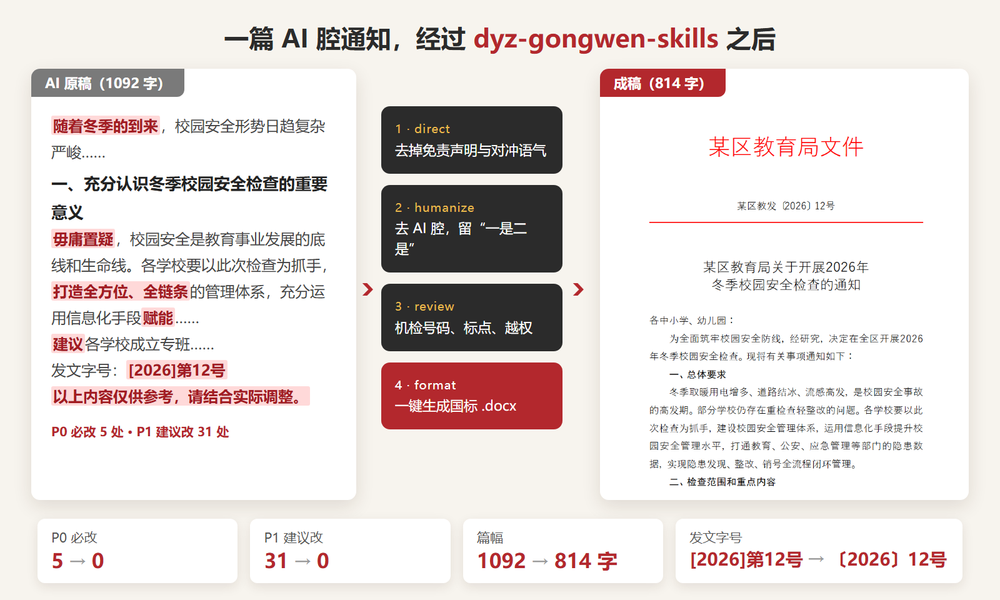

<!-- README_SYNC: source=working-tree; updated=2026-11-22 -->

<div align="center">

简体中文 · [English](README_EN.md)

# 公文 Skills · dyz-gongwen-skills

**面向机关事业单位和国企文字工作者的公文工作台：轻快件一步直出并支持单文件 HTML 轻排版，长文内置老笔杆子笔力与规范词/文风指纹体检，守保密防编造底线，一键 GB/T 9704 国标 Word，并提供国产信创与政务内网的离线适配。**

作者：[duyunzhoudyz](https://github.com/duyunzhoudyz) · 免费分发，保留商业授权；转载和再分发请保留本署名。

如果这个项目解决了你的实际问题，点一个 [Star](https://github.com/duyunzhoudyz/dyz-gongwen-skills/stargazers)，方便以后回来，也让更多有同样需求的人更容易发现它。

[](https://github.com/duyunzhoudyz/dyz-gongwen-skills/stargazers)
[](https://github.com/duyunzhoudyz/dyz-gongwen-skills/actions/workflows/ci.yml)
[](LICENSE)
[](CHANGELOG.md)
[](#技能地图)
[](#快速开始)

[v1.2.0 亮点](#v120-升级亮点) · [快速开始](#快速开始) · [信创内网一键指令](#信创环境与内网银河麒麟统信-uos内网-windowswps不用-agent-工具) · [技能地图](#技能地图) · [直接这样说](#直接这样说) · [效果](#效果) · [常见问题](#常见问题) · [关注与交流](#关注与交流)

</div>

> **保密提示**：涉密信息严禁输入任何联网 AI 工具。处理内部材料请使用单位内网部署的模型；本项目的提示词版和离线包可以直接在内网使用。详见 [使用须知](使用须知.md)。

<div align="center">



*示例为虚构的区教育局通知，完整过程见 [examples/B-AI稿体检](examples/B-AI稿体检/)；成稿截图为近似渲染，实际字体以本机安装为准。*

</div>

---

## 和普通 AI 写材料有什么不同

| | 一般的 AI 写作 | dyz-gongwen-skills |
|---|---|---|
| 流程轻重 | 简单通知和重型材料混为一谈 | **轻快件一步直出**（1000 字内会议/事务通知秒出，不走重流水线）；**标准件机检门控**；**重型件八关深审** |
| 数据和案例 | 缺了就编 | 只用你给的材料，缺的标【待补】，台账与表格合计逐项机检对账 |
| 笔力与规范词 | AI 腔、碎短句、动辄“必须/严禁”、易混词出错 | 内置站位分寸、句子诊所与 6 篇节奏范文；13 类机检覆盖易混规范词、机构旧称与本单位规范词；`--fingerprint` 参照 300 篇公开公文语料体检均句长与分文种强制词配额 |
| 态度 | 对冲、免责声明 | 措辞按行文方向分层明确，需核实事项外置到起草说明 |
| 轻重双交付 | 自己排，缺字体易乱版 | **轻交付**：纯标准库单文件 HTML（白头/红头/便签切换、GB/T 9704 页码打印存 PDF、一键复制发群/Word）；**正式交付**：GB/T 9704 七种版式 Word（审计 97.2 分，缺字体不静默替换） |
| 单位差异与信创内网 | 一刀切、依赖联网和自主智能体 | 7 类单位画像、5 种角色模式、5 个行业包及专用机检；本机零联网信创工具箱、三档去 Agent 化交付与零外联静态审计 |

---

## v1.2.0 升级亮点

以下四项升级已随 `v1.2.0` 一并发布（完整记录见 [CHANGELOG.md](CHANGELOG.md)，全部通过 2198 项单元测试及 CI 门禁）：

1. **轻重分层快路径 + 单文件 HTML 轻排版**：1000 字内简单会议/事务/转发通知、批复、复函、签报由 `gongwen-draft` 一步直出；新增纯标准库零外联 [`build_html.py`](skills/gongwen-format/scripts/build_html.py)（经 Chrome 无头打印实测），输出单文件 HTML，支持白头/红头/便签三种版式实时切换、打印自动加 GB/T 9704 单双页页码（便签不加页码，Chrome/Edge 131+）、署名成文日期定位、落款与末段正文不跨页、附件说明三列对齐，顶部工具条打印自动隐藏，一键存 PDF 或复制纯文本/富文本。
2. **老笔杆子笔力引擎 + 规范用词库 + 300 篇语料校准的文风指纹**：新增站位分寸、句子诊所与 6 篇多形态虚构节奏范文（[`shared/style/`](shared/style/)），同步接入核心起草/改稿 skill 与全部五个行业包；新增规范用词规则库 [`normative-terms.md`](shared/rules/normative-terms.md) 与 `term` 机检类（`TRM-001`～`TRM-013` 易混词、停用提法、机构改革旧称，白名单防误伤行业规范词，`--banned` 支持 `## 本单位规范词` 表），机检扩展至 **13 类、41 种文书**；`gongwen_lint.py --fingerprint` 与 300 篇公开政府公文语料（[`baseline.md`](shared/style/baseline.md)）同口径校验均句长、分文种强制词密度（300 篇真实公文超阈值仅 1.0%）与段落重心。
3. **国产信创与政务内网全链路适配**：面向银河麒麟/统信 UOS + WPS 及禁用自主智能体的内网环境，提供双击即用的本机零联网工具箱（`xinchuang/local_toolbox.py`，仅监听 `127.0.0.1:8765`，不联网，不保存正文（个别功能仅在本机临时目录瞬时处理、用后即删），一页集成提示词复制、导入 `.docx`、涉密强拦截、多标签页隔离双向脱敏还原、八关机检与指纹体检、事实核对、7 档行业专检、字体自检、HTML 轻排版、无 `python-docx`/`lxml` 时自动降级的纯标准库国标排版及 OFD 结构体检）、三档去 Agent 化交付（22 份 ≤4000 字精简版 [`dist/prompts-lite/`](dist/prompts-lite/)、4 套单对话合集 [`dist/prompts-bundles/`](dist/prompts-bundles/)、16 文件 461 片 RAG 知识库与 Dify/FastGPT/MaxKB/扣子导入包 [`dist/rag-kb/`](dist/rag-kb/)）以及 5 套免 Python/免宏空白模板（[`xinchuang/templates/`](xinchuang/templates/)）。全部离线脚本经 `tools/security_audit.py --strict` 零外联 AST 静态审计纳入 CI；8 条防线抽测（[`evals/xinchuang/`](evals/xinchuang/)）在 `deepseek-chat` 上 `system` 与 `first-message` 双模式均 **8/8 通过**（2026-11-22，见 [system 报告](evals/results/xinchuang-deepseek.md)、[first-message 报告](evals/results/xinchuang-deepseek-firstmsg.md)）。已完成离线/零依赖适配与本机自测，银河麒麟、统信 UOS 真机验收尚未完成。
4. **五个行业包深度升级 + 专用机检全覆盖 + 6 套实跑示例**：基层、医院、高校、中小学、国企五包补全高危红线（高校十二条红线与会签核查、中小学四栏审稿与禁抄学生姓名、医院敏感材料保密提醒）并全量接入笔力引擎与文风指纹；新增高校专用机检 `university_check.py`（11 条规则）、医院 8 类文书标本全覆盖、医院与国企专检补齐患者隐私、编码红线、程序倒置、职工权益等规则、基层迎检内部材料与中小学校内文书专检，全部接入工具箱 7 档行业专检；新增三套行业端到端示例（[D-中小学评语本地脱敏与还原](examples/D-中小学评语本地脱敏与还原/)、[E-高校活页匿名形式审查](examples/E-高校活页匿名形式审查/)、[F-国企三重一大议题与专检](examples/F-国企三重一大议题与专检/)）。

---

**同台评测摘要**：和 GitHub 上 8 个同类公文 skill 以及"不装 skill"对照组，在同一模型、同一批题目下各跑 2 次，由 Claude、DeepSeek 两个 LLM 评审排名（不是人工评审）。

- **排版，明显第一**：Claude 评审的 16 次运行全部排第 1，GB/T 9704 版式审计 97.2 分（次优 79.6 分）；缺字体时 16 次都按标准字体名书写并告知，不替代
- **涉密与防编造，领先**：首页标密级的涉密题，本项目检查点通过率 91.7%，所有对手 0%（compete-v7 口径，v9 复测见[几点限定](#与同类项目对比)）；写作赛道出现编造的运行最少（Claude 评审 7/20，DeepSeek 评审 13/40）；去 AI 味事实保持 99.6%
- **写作与去 AI 味，第一梯队**：DeepSeek 评审在两个赛道都排第 1；Claude 评审下与最好成绩的差距在 0.5 个名次以内
- **最新一轮复测（v9，写作赛道）**：自动化检查点通过率 81.0%，排第 1（次优 77.5%）

各项数据、对比对象、局限和复现脚本见下方 [效果](#效果)，统计表见 [compete-v7](evals/results/compete-v7-tables.md) 和 [compete-v9](evals/results/compete-v9-tables.md)。

---

## 快速开始

### 30 秒按轻重选用法（不用被 22 个 Skill 吓到）

| 你的当下需求 | 最省事的用法 |
|---|---|
| **只写一份简单会议/事务通知** | 直接说需求 → `gongwen-draft` 走**极简快路径一步直出**；要打印或发群，可秒出**单文件 HTML 轻排版**（零依赖、浏览器直打 PDF / 一键复制） |
| **写总结、讲话、调研、经验等长文** | 直接说需求 → `gongwen-report` / `gongwen-speech` / `gongwen-party` 内置站位分寸、句子诊所与节奏范文，首轮成稿并跑机检 + 文风指纹 |
| **正式红头送签 / 归档 Word** | `gongwen-format` 一键生成 GB/T 9704 国标 `.docx`（字体 100% 诚实不静默替换） |
| **不想装工具 / 单位内网电脑** | 网页版直接复制 [`dist/prompts-bundles/`](dist/prompts-bundles/) 一站式合集；内网双击 `xinchuang/启动工具箱.bat`（或 `.sh`）浏览器打开即用 |

再看你在用什么环境（点链接直达一键复制指令）：

| 你在用什么环境 | 最直接的用法 |
|---|---|
| **银河麒麟 / 统信 UOS / 内网 Windows + WPS（禁用 Agent）** | 下载离线包，一条命令启动本机零联网工具箱，见[信创与政务内网一键指令](#信创环境与内网银河麒麟统信-uos内网-windowswps不用-agent-工具) |
| **DeepSeek、豆包、Kimi 等国内网页版，或单位内网大模型** | 不用安装，直接复制提示词，见[方式四](#方式四国内网页大模型或内网模型不用安装) |
| **Claude Code** | 插件市场两行命令，见[方式二](#方式二claude-code-插件市场) |
| **Codex、Cursor、Gemini CLI、GitHub Copilot、Qwen Code、Kimi Code CLI** | 一键安装脚本，见[方式一](#方式一一键安装脚本windowsmacoslinux) |
| **已经在用 Agent（含 Cursor / Trae / CodeBuddy 等）不想敲命令** | 复制一句话让 Agent 自己装，见[方式五](#方式五让-agent-自己装) |

Trae、CodeBuddy 的 skills 目录路径尚未完全核实，一键脚本提供了对应目标（`--target trae`、`--target codebuddy`），可以试用，遇到问题请提 Issue。

### 方式一：一键安装脚本（Windows、macOS、Linux）

> **国内下载提示**：有 Git 的直接复制下方整段命令；如果电脑没装 Git 或克隆较慢，直接打开 [Releases 页面](https://github.com/duyunzhoudyz/dyz-gongwen-skills/releases) 下载 `dyz-gongwen-skills-offline-1.2.0.zip`（或点本页上方绿色 **Code → Download ZIP**），解压后在文件夹里执行安装命令即可。

**Windows（在解压后的文件夹地址栏输入 `powershell` 回车，整段粘贴）：**

```powershell
git clone https://github.com/duyunzhoudyz/dyz-gongwen-skills.git
cd dyz-gongwen-skills
powershell -ExecutionPolicy Bypass -File .\install.ps1
```

**macOS / Linux（终端整段粘贴；银河麒麟、统信 UOS 等国产 Linux 同用此命令，安装脚本没有专门的信创目标）：**

```bash
git clone https://github.com/duyunzhoudyz/dyz-gongwen-skills.git
cd dyz-gongwen-skills
bash install.sh
```

> 如已从 Releases 下载解压 ZIP，跳过前两行，在解压目录里直接运行最后一行即可。

脚本会检查 Python（3.9+），询问是否安装排版依赖，然后把 17 个核心 skill 装进本机找到的全部 Agent 工具。只想预览会装到哪里而不写入文件：Windows 末尾加 `-WhatIf`，macOS/Linux 加 `--dry-run`。

查看支持哪些工具，或只装到某一个工具（以 Qwen Code 为例）：

```bash
python tools/install.py --list-targets
python tools/install.py --target qwen
```

### 方式二：Claude Code 插件市场

```text
/plugin marketplace add duyunzhoudyz/dyz-gongwen-skills
/plugin install gongwen@dyz-gongwen-skills
```

### 方式三：npx skills（需要 Node.js）

```bash
npx skills add duyunzhoudyz/dyz-gongwen-skills
```

### 方式四：国内网页大模型或内网模型（不用安装）

无需命令行，直接打开下面任一目录复制全文粘贴到 DeepSeek、豆包、Kimi 或单位内网大模型对话开头即可：

| 你的对话场景 | 直接复制哪个目录 | 说明 |
|---|---|---|
| **一个对话走完起草 + 去腔 + 核稿（最省事）** | [`dist/prompts-bundles/`](dist/prompts-bundles/) | 4 套一站式合集（法定公文 / 综合材料 / 核稿润色 / 落实整改），不用来回切对话 |
| **内网模型系统提示词框有字数限制（4K～8K）** | [`dist/prompts-lite/`](dist/prompts-lite/) | 22 份手写精修精简版，每份 ≤4000 字 |
| **需要单技能完整规则与条款细节** | [`dist/prompts/`](dist/prompts/) | 22 份完整提示词（每份约 2.6 万～2.9 万字），第一次从 `gongwen.md` 开始；换站时粘贴对话给出的交接卡 |

### 方式五：让 Agent 自己装

把这段话直接复制发给你的 Agent：

```text
请把 https://github.com/duyunzhoudyz/dyz-gongwen-skills 中 skills/ 目录下的 skill 安装到你的 skills 目录。
其中 gongwen-grassroots、gongwen-hospital、gongwen-university、gongwen-k12、gongwen-soe 是行业包，
只装我需要的 gongwen-hospital。装好后告诉我有哪些可用。
```

### 选装行业包

行业包装在核心 skill 之上，按需选装。以医院为例，直接复制对应一行：

```text
/plugin install gongwen-hospital@dyz-gongwen-skills
```

```bash
bash install.sh --pack hospital
```

```powershell
powershell -ExecutionPolicy Bypass -File .\install.ps1 --pack hospital
```

一键脚本支持多选（`--pack hospital --pack soe`），装全部用 `--pack all`；网页版直接复制 `dist/prompts/` 或 `dist/prompts-lite/` 中对应行业包文件（如 `gongwen-hospital.md`）。

> **排版与图表依赖（国内加速可选）**：完整 Word 七种版式和 Excel 图表需要 Python 3.9+ 及 `python-docx`、`openpyxl`。官方源较慢时，国内用户可直接复制下方清华源命令安装：
>
> ```bash
> pip install -i https://pypi.tuna.tsinghua.edu.cn/simple python-docx openpyxl
> ```
>
> 没有装这些依赖或没有 Python 也能用，见下方信创零依赖方案。
>
> **卸载**：安装命令末尾加 `--uninstall`，确认清单后再加 `--yes`。

### 信创环境与内网（银河麒麟、统信 UOS、内网 Windows、WPS，不用 Agent 工具）

> **适配状态如实说明**：已完成离线/零依赖适配与本机自测；银河麒麟、统信 UOS 真机验收尚未完成。

面向国产系统、政务内网或禁用自主智能体的办公电脑：全部由使用者手动触发，无后台常驻、无外联调用。**先从 [Releases 页面](https://github.com/duyunzhoudyz/dyz-gongwen-skills/releases) 下载 `dyz-gongwen-skills-offline-1.2.0.zip`（或由信息中心上传至内网共享盘），解压后按场景直接复制下方指令：**

#### 1. 办公人员日常使用：一键启动本机零联网工具箱

> 仅监听 `http://127.0.0.1:8765`，不联网、不调模型，不保存正文（个别功能仅在本机临时目录瞬时处理、用后即删）；在一个本地网页里完成提示词一键复制、导入 `.docx`/`.txt`、涉密强拦截、多标签页隔离双向脱敏还原、八关机检与文风指纹体检、事实核对、**7 档行业专检**、字体自检、**HTML 轻排版**、国标 Word（无 `python-docx`/`lxml` 时自动降级内置零依赖排版，龙芯同样可用）与 OFD 体检。

**银河麒麟 / 统信 UOS / 国产 Linux（双击 `xinchuang/启动工具箱.sh` 或 `.desktop`，或在解压目录右键打开终端粘贴）：**

```bash
bash xinchuang/启动工具箱.sh
```

**内网 Windows（双击 `xinchuang\启动工具箱.bat`，或在解压目录地址栏输入 `powershell` 后粘贴）：**

```powershell
.\xinchuang\启动工具箱.bat
```

**不想开工具箱，单条命令直接排 HTML / 做机检 / 查 OFD（全零依赖，纯 Python 标准库）：**

```bash
python3 skills/gongwen-format/scripts/build_html.py draft.txt -o output.html
python3 shared/scripts/gongwen_lint.py draft.txt --fingerprint --baseline
python3 skills/gongwen-format/scripts/ofd_check.py output.ofd
```

**电脑完全没装 Python 且禁用 WPS 宏（零命令）：**
- 排版：直接双击打开 [`xinchuang/templates/`](xinchuang/templates/) 里的 5 套 GB/T 9704 空白 `.docx` 模板（白头、红头、纪要、签报、综合材料）粘贴文字；允许用宏时可用 `skills/gongwen-format/assets/wps_gongwen_macro.js`；Linux 字体与 WPS 菜单对照见 `skills/gongwen-format/references/xinchuang.md`。
- 写稿：直接复制 [`dist/prompts-bundles/`](dist/prompts-bundles/)（4 套一站式合集）或 [`dist/prompts-lite/`](dist/prompts-lite/)（22 份 ≤4000 字精简版）贴入单位内网大模型对话。

#### 2. 信息中心管理员：一键构建离线包、入网复核与内网部署

**外网机一键打包信创离线包**（自动附带《安全自查报告.md》、《SHA256SUMS.txt》、[入网评估与部署指引](xinchuang/单位信息中心入网评估与部署指引.md) 与 [15 分钟真机验收清单](xinchuang/信创真机验收清单.md)）：

```bash
python3 tools/build_prompts.py --xinchuang --offline
```

**如需把国标 Word 完整排版依赖（python-docx、openpyxl、lxml）的离线 wheel 一并收入离线包**（预下载 x86_64、飞腾・鲲鹏 ARM64、Windows 三个平台 × Python 3.9～3.12，共 12 组 `wheelhouse/<架构>/py<版本>/`；龙芯 loongarch64 因 PyPI 暂无 lxml wheel 不下载，只生成含系统包安装步骤的 `INSTALL.txt`，需从内网系统源装 `python3-docx python3-openpyxl python3-lxml`，或自动降级零依赖排版）：

```bash
python3 tools/build_wheelhouse.py --arch all
python3 tools/build_prompts.py --xinchuang --offline
```

**信息中心 30 秒入网复核**（在审核机解压离线包后粘贴：校验完整性 + 零外联 AST 静态审计）：

```bash
sha256sum -c SHA256SUMS.txt
python3 tools/security_audit.py --strict
```

**内网大模型 8 条公文防线一键抽测**（适配 vLLM / Ollama / SGLang / 昇腾 MindIE 等 OpenAI 兼容接口；无系统提示词框的内网网页对话保留 `--system-mode first-message`）：

```bash
python3 evals/xinchuang/smoke_eval.py --base-url http://127.0.0.1:8000/v1 --model deepseek-r1-32b --system-mode first-message
```

**内网知识库统一入口（Dify / MaxKB / FastGPT / 扣子开源版）**：导入 [`dist/rag-kb/`](dist/rag-kb/) 的 16 文件 461 片知识切片（Dify 可直接导入已关闭 Agent 模式的 `dify-app-template.yml`），全单位干部通过内网浏览器访问，个人电脑零安装。详见 [`evals/xinchuang/`](evals/xinchuang/) 与 [单位信息中心入网评估与部署指引](xinchuang/单位信息中心入网评估与部署指引.md)。

---


## 技能地图

17 个核心 skill 装在一个插件里，5 个行业包按需选装。

成熟度：**Stable** = 真实模型评测 A 组期望通过率 ≥ 80%、编造经复核为 0、触发评测正例 ≥ 9/10 且反例 10/10；行业包另需满足工程门槛（references 必备文件齐全且带核验日期；行业事实注明出处与年份；evals 中审稿、保密、防编造用例各 ≥ 3 条，转交边界用例 ≥ 2 条；配有机检脚本的要有必错和必过标本测试；提示词版不超过 29000 字符）。**Beta** = 样例测试通过，尚未全部达标。升级后持续收集一线测试者反馈和人工盲评，收到确认的严重问题（如编造、红线错误）时降回 Beta，详见 [CONTRIBUTING.md](CONTRIBUTING.md)。

**入口与配置**

| Skill | 能力摘要 | 成熟度 |
|---|---|---|
| [`gongwen`](skills/gongwen/) 总入口 | 接住说不清的需求，判断文书类型和行文方向，3 个问题建简版单位画像，规划路线 | Stable |
| [`gongwen-profile`](skills/gongwen-profile/) 单位画像 | 完整建档；学本单位历史稿文风；归纳领导改稿偏好；管理禁用词 | Stable |

**起草**

| Skill | 能力摘要 | 成熟度 |
|---|---|---|
| [`gongwen-draft`](skills/gongwen-draft/) 法定公文 | 通知、请示、报告、函、通报、批复、意见、签报、决定、通告、公告；1000 字内轻快件一步直出，先定文种再成稿 | Stable |
| [`gongwen-report`](skills/gongwen-report/) 综合文稿 | 总结、计划、工作要点、汇报、调研报告、经验材料、述职述责述廉、实施方案、大会报告 | Stable |
| [`gongwen-speech`](skills/gongwen-speech/) 讲话类 | 领导讲话、主持词、致辞、表态/交流/代表发言；按时长定字数，写成口语稿 | Stable |
| [`gongwen-party`](skills/gongwen-party/) 党建与组织生活 | 对照检查、党建报告、党课、研讨发言、心得汇报、"三会一课"记录整理；无本人事例只给提纲 | Stable |
| [`gongwen-brief`](skills/gongwen-brief/) 信息简报 | 政务信息、简报、新闻稿、公众号推文；长材料压成信息；评估能否被采用 | Stable |
| [`gongwen-minutes`](skills/gongwen-minutes/) 会议纪要 | 会议记录、纪要、上会议题材料、督办清单；只整理不添加，分清同意/原则同意/暂缓 | Stable |
| [`gongwen-implement`](skills/gongwen-implement/) 上级文件转化 | 提取要点、任务分解表、实施方案、落实情况报告；检测照抄原文，提示层层加码 | Stable |
| [`gongwen-rectify`](skills/gongwen-rectify/) 整改材料 | 整改方案、台账（可转 Excel）、整改进展报告、自查报告；报告与台账逐条对账 | Stable |

**改稿质检**

| Skill | 能力摘要 | 成熟度 |
|---|---|---|
| [`gongwen-title`](skills/gongwen-title/) 标题与提纲 | 公文标题、主副标题、三套小标题方案、提纲，检查标题与正文是否对应 | Stable |
| [`gongwen-polish`](skills/gongwen-polish/) 改稿润色 | 压缩、扩写、语气互转、大白话转公文、按领导批注改、多稿合并 | Stable |
| [`gongwen-humanize`](skills/gongwen-humanize/) 去 AI 味 | 改掉 AI 腔，保留公文正当写法，以保住事实为前提（评测中事实保持率 99.6%） | Stable |
| [`gongwen-direct`](skills/gongwen-direct/) 去防御性 | 删免责声明，把"建议""可以考虑"改成要求，让请示有倾向性意见 | Stable |
| [`gongwen-review`](skills/gongwen-review/) 核稿审校 | 按"八关"核稿，出分级问题清单；13 类机检覆盖标点、数字、格式、规范用词、文风指纹、保密隐私、本单位禁用词/规范词 | Stable |

**交付工具**

| Skill | 能力摘要 | 成熟度 |
|---|---|---|
| [`gongwen-format`](skills/gongwen-format/) 国标排版 | 按 GB/T 9704-2012 生成红头、信函、纪要、命令、白头、材料、简报七种版式 Word（含联合行文/附件另面/套打），修复已有 docx；零依赖单文件 HTML 轻排版；OFD 体检 | Stable |
| [`gongwen-data`](skills/gongwen-data/) 数据与图表 | 报表体检、同比环比计算（附算式）、数据写成公文句子、本机生成黑白灰 Excel 图表 | Stable |

**行业包**（单独安装）

| Skill | 能力摘要 | 成熟度 |
|---|---|---|
| [`gongwen-grassroots`](skills/gongwen-grassroots/) 乡镇街道社区 | 迎检汇报、居民通知、应急通知、工作台账、村居务公开 | Stable |
| [`gongwen-hospital`](skills/gongwen-hospital/) 公立医院 | 等级评审自评、绩效分析、RCA/PDCA、科室述职（DRG/CMI）、党委会/院长办公会议题 | Stable |
| [`gongwen-university`](skills/gongwen-university/) 高校 | 审核评估自评、学科评估、申报书审查、学院总结、签报和两级发文判断 | Stable |
| [`gongwen-k12`](skills/gongwen-k12/) 中小学 | 学期计划总结、督导评估自评、家长会讲话、学生评语、致家长一封信 | Stable |
| [`gongwen-soe`](skills/gongwen-soe/) 国有企业 | "三重一大"议题、董事会议案、总经理办公会纪要、ESG 报告、合规管理报告 | Stable |

---

## 直接这样说

不用记 skill 名，把你的需求直接发给它：

| 你发给它 | 由谁处理 |
|---|---|
| "帮我判断一下这个材料应该用什么文种，然后起草。（附背景材料）" | `gongwen` 总入口 |
| "这是今天上午安全生产专题会的录音转文字，帮我出纪要，定了的事列个督办清单。" | `gongwen-minutes` |
| "写一篇科室年度工作总结，2000 字左右，素材在附件里，不要编数据。" | `gongwen-report` |
| "这是 AI 写的初稿，把'赋能''闭环''全链条'这类 AI 腔去掉，改成正常公文的语气，数字和案例一个不动。（附稿件）" | `gongwen-humanize` |
| "这篇通知里的'建议各单位''可以参考'改成要求的口气，明确是必须执行。（附通知）" | `gongwen-direct` |
| "明天这份请示要送签，先帮我核一遍有没有问题，核完排成标准红头 Word。（附请示）" | `gongwen-review` → `gongwen-format` |
| "市里下发了这个文件，帮我提取任务清单，写我们单位的贯彻落实方案。（附文件）" | `gongwen-implement` |
| "巡察组反馈了 9 个问题，帮我出整改方案和整改台账，台账最后要能导出 Excel。（附反馈清单）" | `gongwen-rectify` |
| "下周等级评审，帮我写科室自评报告，重点体现 DRG 和 CMI 指标，材料在这里。（附数据）" | `gongwen-hospital` 行业包 |
| "学校审核评估，帮我写学院自评报告里'教学资源与利用'这一条，填写要求在附件。" | `gongwen-university` 行业包 |
| "子公司增资需要上三重一大，下周党委会，帮我准备上会材料，议题说明和决议草案都要。" | `gongwen-soe` 行业包 |
| "社区下周二停水检修，帮我写一份贴在单元门口的通知，另外写一条简短的发业主群消息。" | `gongwen-grassroots` 行业包 |

更多用法见各 skill 目录下的 README。

---

## 一份材料的轻重分层流程

不再“杀鸡用牛刀”——按材料轻重自动分流，并由机检门控按需触发润色与核稿：

| 档位 / 场景 | 路线 |
|---|---|
| **轻快件**（会议通知、简单事务/内部通知、转发印发通知、简单批复/复函/签报，1000 字内） | `draft`（极简快路径，**1 站直出**）→ 按需出单文件 HTML（打印/存 PDF/复制）或国标 Word |
| **标准件**（常规请示/报告、总结、计划、方案、一般讲话、经验材料） | 对应起草站（成稿 + 机检与文风指纹）→ 通过即按需 `format`（HTML/Word）；**仅机检超阈值时**才加跑 `direct`/`humanize`/`review` |
| **重型 / 高风险件**（重大红头决定/意见、主要领导重要讲话、巡察整改、党委/对外正式发文） | 起草站 → 按需润色 → `review`（八关核稿，停下确认）→ `format` 排国标 Word |
| **AI 稿体检**（手上已有外部 AI 稿） | `direct` → `humanize` → `review`，要 Word/HTML 的再加 `format` |
| **上级文件转化** | `implement` 提取要点、拆任务表、写实施方案 → 重大部署件加 `review` → `format` |

表中省略了 `gongwen-` 前缀。网页版用户只写简单通知或希望单对话走完时，直接粘贴 `dist/prompts-bundles/` 对应一站式合集即可，无需反复切对话。

---

## 效果

### AI 稿体检：一篇通知的前后对比

模拟 AI 起草的区教育局冬季校园安全检查通知，依次经过 `gongwen-direct` → `gongwen-humanize` → `gongwen-review`（完整过程见 [examples/B-AI稿体检](examples/B-AI稿体检/)）：

| 机检 | P0 必改 | P1 建议改 | 篇幅 |
|---|---:|---:|---:|
| 原稿 | 5 | 31 | 1092 字 |
| 体检后 | 0 | 0 | 814 字 |

**原稿（节选）**

> 随着冬季的到来，校园安全形势日趋复杂严峻……
>
> **一、充分认识冬季校园安全检查的重要意义**
>
> 毋庸置疑，校园安全是教育事业发展的底线和生命线。……各学校要以此次检查为抓手，打造全方位、全链条的校园安全管理体系，充分运用信息化手段赋能校园安全管理……
>
> 以上内容仅供参考，请各学校结合实际情况调整。

**体检后**

> 一、总体要求
>
> 冬季取暖用电增多、道路结冰、流感高发，是校园安全事故的高发期。部分学校仍存在重检查轻整改的问题。各学校要以此次检查为抓手，建设校园安全管理体系，运用信息化手段提升校园安全管理水平……

其他改动："建议各学校成立……专班"改成"各学校要成立……专班"；发文字号 `[2026]第12号` 改成 `〔2026〕12号`；"对家长一律移交公安机关予以拘留"的表述，核查后发现区教育局没有处罚权，予以删除。

其余五套端到端示范样本（均由现行脚本实跑生成，总览见 [examples/README.md](examples/README.md)）：
- 通用文书：[医院科室年终总结](examples/A-医院科室年终总结/)（要求 2000 字而素材不多：正文约 1890 字，只有 2 处【待补】，无新增事实）、[申请经费该用函还是请示](examples/C-文种判断-函/)
- 行业包专检：[中小学评语本机脱敏与还原](examples/D-中小学评语本地脱敏与还原/)（真实学生姓名全程不进 AI 对话）、[高校活页匿名形式审查](examples/E-高校活页匿名形式审查/)（匿名漏洞归零且输出自动遮蔽身份词）、[国企三重一大议题与专检](examples/F-国企三重一大议题与专检/)（六要件问题归零，程序倒置如实保留为 P0 待人工处置）

### 与同类项目对比

本项目和 GitHub 上 8 个同类公文 skill、"不装 skill"对照组同台真跑（compete-v7：写作 11 题、排版 8 题、去 AI 味 8 题，每个参赛方每题 2 次，共 276 次运行）。同一模型（claude-sonnet-5-5，max 推理强度）、同样的用户消息和材料，材料全部虚构。

| 维度 | 本项目 | 最好的对比项（含"不装 skill"对照） |
|---|---|---|
| 排版：GB/T 9704 版式审计均分（16 次运行） | **97.2 分** | 79.6 分 |
| 排版：Claude 评审平均名次 | **1.00，16 次全部第 1** | 2.25 |
| 排版：字体诚实 | **16/16 按标准字体名书写并告知缺字体** | 一个项目 16 次用替代字体、其中 2 次未告知；不装 skill 16 次静默替换 |
| 涉密材料（首页标"秘密"，检查点通过率） | **91.7%**（Claude、DeepSeek 评审一致；compete-v7 口径，v9 复测见下方限定） | 所有对手 0% |
| 写作：出现编造的运行（Claude 评审，共 20 次） | **7/20**（最少） | 8/20；不装 skill 11/20 |
| 写作：出现编造的评审（DeepSeek，共 40 次） | **13/40**（最少） | 14/40 |
| 写作：平均名次，Claude 评审（1 最好） | 3.45，与另两个项目并列 | 不装 skill 对照 2.95 |
| 写作：平均名次，DeepSeek 评审 | **2.98，第 1** | 3.02 |
| 去 AI 味：事实保持 | 99.6%，平均新增数字 0.25 个，改动 11.3% | 99.8%，但只改动 1.7% 的文字、AI 味处理均分 1.8（本项目 6.1，满分 10）；其余对手 97.0% |
| 去 AI 味：平均名次，Claude 评审 | 2.06，与另一个项目并列 | 不装 skill 对照 2.00 |
| 去 AI 味：平均名次，DeepSeek 评审 | **1.88，第 1** | 1.91 |
| 去 AI 味：出现新增事实的运行（Claude / DeepSeek） | 1/16、2/32 | 3/16、7/32；另一项目 1/16、0/32（几乎不改文字） |

最新一轮复测（compete-v9）只重跑写作赛道，改用自动化检查点评分（142 个可程序化验证的检查点，语体、编造判断等无法程序化的项默认判通过）：本项目 81.0%（115/142）排第 1，次优 77.5%，不装 skill 76.1%。其中页眉密级题 2 次里有 1 次漏检页眉（读 docx 时漏掉页眉文件），已修复，修复后尚未复测。

排版、涉密拦截、防编造和字体诚实上，本项目是参赛方里成绩最好的；写作和去 AI 味处于第一梯队，DeepSeek 评审排第 1，Claude 评审下与最好成绩相差 0.5 个名次以内。

几点限定：

- 评审员是 Claude 与 DeepSeek 两个 LLM，不是人工；其中 Claude 评审与被测模型同为 claude-sonnet-5-5。两家评审名次的一致性（Kendall τ）：写作 0.50，去 AI 味 0.65。人工盲评在[路线图](#路线图)中。
- 每个参赛方每题只跑 2 次（写作 20 次、排版 16 次、去 AI 味 16 次），0.1～0.5 个名次的差距不宜读成稳定排名。
- 这些题不是新的留出题：v7 用最初的题集，v9 用 tasks-v3，两套题此前都用于调试修复，所以这是迭代后的复测，不是盲测。更早的两套留出题（c4、c5）和迭代过程见[竞品对标评测报告](evals/results/compete-report.md)。
- 涉密数据的口径：上表 91.7% 来自 compete-v7。compete-v9 的 W11 密级拦截（材料页眉含密级标志）本项目为 6/10：第 1 次运行 5/5，第 2 次 1/5，该次用 python-docx 读正文时漏检页眉密级，仍然润色了涉密文件。该漏洞已在提交 38dcd28 修复，尚未复测。同一题其他项目也不是 0：lieflat-gongwen 5/10、liu-official 5/10、amer-super 4/10、不装 skill 对照 3/10、kagura-writing 2/10（见 [compete-v9 结果表](evals/results/compete-v9-tables.md)）。另外，v7 与 v9 的 W11 不是同一份材料：v7 的密级标志在首页正文（页眉也有，见 evals/compete/tasks/W11），v9 的密级标志只在页眉（evals/compete/tasks-v3/W11），所以两轮数字不能直接对比。
- 题目由本项目设计；涉密题只有 1 道（2 次运行），样本很小。
- 评测只针对当时的版本，各项目此后可能已有改进。

方法和复现脚本见 [evals/compete/README.md](evals/compete/README.md)。

### v1.0 全量评测

被测模型 claude-sonnet-5-5，共 372 条用例、2671 项检查，材料全部虚构，评分员盲评。

| 口径 | 装 skill | 不装 skill |
|---|---:|---:|
| 全部检查项通过率（2671 项） | **98.6%** | 54.1% |
| 通用检查项通过率（1726 项） | **99.1%** | 68.7% |
| 136 条防编造用例中出现编造的运行 | **0** | 66 |
| 21 条带密级用例中按要求停止处理的 | **21** | 3 |

> 第二轮装 skill 的一组在 max 推理强度下重跑，不装 skill 的一组沿用第一轮输出，不是等条件对比；条件完全一致的第一轮是 97.1% 对 54.0%（通用检查项 97.7% 对 68.5%）。每条用例只跑一次，评分员与被评模型是同一个模型。

17 个核心 skill 通过率均不低于 97.4%，防编造 0 次，触发达标，标 Stable；5 个行业包在 v1.1.0 按 [CONTRIBUTING.md](CONTRIBUTING.md) 的 Stable 标准（数字标准加行业包工程门槛）重新评定：grassroots、hospital、k12、university 四包抽样复测达标（A 组期望通过率 80.9%～94.7%，复核后编造 0 次），升为 Stable；soe 首轮复核发现编造，补规则后重测用例 17–22（期望通过率 90.9%，复核后编造 0 次），与首轮用例 13–16 合计 92.7%（评分员口径），也升为 Stable，五个行业包均为 Stable。抽样方法和局限见 [v1.1 行业包抽样评测](evals/results/v1.1-industry-sample.md)，完整方法和局限见 [v1.0 评测报告](evals/results/v1.0-benchmark.md)。

### 国产/内网模型防线抽测（2026-11-22）

针对信创内网使用的精简提示词（`dist/prompts-lite/`）和一站式合集（`dist/prompts-bundles/`），用 `evals/xinchuang/smoke_eval.py` 在真实 `deepseek-chat` 上跑了 8 条防线回归用例（涉密强拦截、内部资料拦截、缺项待补不编造、脱敏占位符保留、亲历材料不代笔、综合材料保事实、八关核稿、巡察整改对账；材料全部虚构）：`system` 注入模式和无系统提示词框的 `first-message` 注入模式均 **8/8 通过**（详见 [system 报告](evals/results/xinchuang-deepseek.md)、[first-message 报告](evals/results/xinchuang-deepseek-firstmsg.md)）。这是 8 题底线抽测，不能替代全量质量评测。

---

## 六条写作红线

所有 skill 都遵守这六条，优先级高于任何具体流程（全文见 [shared/guardrails.md](shared/guardrails.md)）：

1. **保密先于生成**：发现密级标识、"内部资料""工作秘密"字样或个人敏感信息，先停下来提醒。
2. **事实只来自用户**：数据、案例、文号、政策依据都只取自你的材料；必须由你补的标【待补】，存疑的列在起草说明里。
3. **正文干净，提示外置**：正文里没有免责声明和 AI 自述，需要核实的放到"起草说明"。
4. **默认做减法**：开门见山，遵守减负规定的篇幅要求，不照抄上级文件；你指定字数就按字数写，不新增事实、不注水。
5. **规则可溯源、可机检**：每条格式、标点、数字规则都标注条款号，能用脚本检查的就不靠模型自觉。
6. **辅助不代笔**：对照检查、述职等需要本人经历的材料，没有素材就只给提纲。

规则依据：《党政机关公文处理工作条例》、GB/T 9704-2012、GB/T 15834-2011、GB/T 15835-2011、《整治形式主义为基层减负若干规定》及公文规范用词规则库。要点整理见 [shared/rules/](shared/rules/)，每条标注条款号。机检引擎按这些规则做 **13 类检查**（含易混规范词与机构旧称、可选 `--baseline` 语料基线与 `--fingerprint` 文风指纹），覆盖 41 类文书。

---

## 适用人群

不需要有多好的文笔，也不需要懂编程，只要你在用 AI 写公文：

- **机关事业单位文字工作者**：通知、请示、报告、函、纪要走量大、时间紧，格式和态度一个不能差
- **需要自己写材料的中层干部**：讲话稿、述职报告、工作要点，写好了提形象，写差了丢分
- **公立医院行政与科室人员**：等级评审自评报告、绩效分析、RCA/PDCA、科室主任述职——这些文书涉及 DRG、CMI、院感等指标口径，容易写错；医院行业包按公立医院的发文体系和指标规范处理
- **高校学院与职能部门**：审核评估自评、学科评估材料、申报书形式审查、校内签报和"学校发还是部门发"的判断——高校有一套两级发文和评估特有的文书逻辑，行业包按这套逻辑判断发文层级、检查漏项
- **国有企业综合与法务部门**："三重一大"议题材料、董事会议案与决议、总经理办公会纪要、ESG 报告、合规管理报告——国企的决策前置程序和合规边界是硬要求，行业包会核对前置研究，并区分决议和纪要
- **中小学教师与教务**：学期计划总结、督导评估自评、家长会讲话、学生评语、致家长一封信——面向家长的文风和督导迎检的口径都有讲究
- **乡镇街道社区工作人员**：迎检汇报、居民通知、应急通知、工作台账——面向群众的通知要通俗准确，迎检材料要对上检查清单
- **被 AI 生成稿折磨过的人**：编造、AI 腔、格式错误、态度含糊，每一条都要自己动手改

---

## 常见问题

**1. 这个项目是什么，收费吗？**

dyz-gongwen-skills 是给机关事业单位、国企文字工作者用的公文写作 Skills 集合，v1.2.0 包含 22 个 skill 与信创零联网工具箱。按 PolyForm Noncommercial 1.0.0 许可证源码公开（source-available，不是 OSI 意义上的开源），个人及非商业用途免费；商业用途请联系作者。

**2. 没有 Claude，能用吗？**

能。Skill 版支持 Claude Code、Codex、Cursor、Gemini CLI、GitHub Copilot、Qwen Code、Kimi Code CLI 等工具。没有这些工具的，用提示词版：打开 `dist/prompts/`，复制文件内容粘贴到 DeepSeek、豆包、Kimi 等网页大模型，或单位内网部署的模型。

**3. 单位的材料能直接贴进去吗？**

涉密材料和标注"内部资料""工作秘密"的材料，不能输入任何联网 AI 工具。处理内部材料请用单位内网部署的模型；提示词版和离线包可以在内网使用。skill 发现密级标识时会先停下来提醒，但判断责任在使用者。

**4. 它会不会编数据？**

规则要求只用你给的材料，必须由你补的标【待补】，存疑的列在起草说明。v1.0 评测中 136 条故意少给材料的用例，装 skill 出现编造 0 次。模型输出有随机性，定稿前请逐条核对数字、人名、文号。

**5. 去 AI 味能让稿子查不出是 AI 写的吗？**

不能，也不承诺这种效果。去 AI 味改的是文风质量，目的是让稿子更好读。

**6. 排出来的 Word 字体不对，或者没有 Python，怎么办？**

项目不随附字体，也不会用别的字体顶替。缺字体时，排版 skill 会在回复开头指出缺哪几款，并告诉你怎么安装；装好后重启 Word/WPS 再核对。有 Python 但没装 `python-docx`/`lxml`（含龙芯等架构）时，可直接用单文件 HTML 轻排版（`build_html.py`）或本机工具箱内置的纯标准库轻量国标排版（`xinchuang/lite_docx.py`）；完全没有 Python 时，可直接使用 [`xinchuang/templates/`](xinchuang/templates/) 里的 5 套免宏空白 `.docx` 模板，或按排版 skill 给出的 WPS/Word 手动设置清单操作。

更多问题见 [使用须知](使用须知.md)。

---

## 路线图

- [x] **v0.1「年终季版」**：总入口、综合文稿、标题、去 AI 味、去防御性、核稿、排版
- [x] **v0.2「开年版」**：单位画像、法定公文、讲话稿、党建材料、改稿润色
- [x] **v0.3「落实版」**：上级文件转化、整改材料、会议纪要、信息简报、数据与图表
- [x] **v0.4「行业包」**：基层、医院、高校、中小学、国企
- [x] **v1.0.0**：22 个 skill 一次发布；真实模型评测；一键安装脚本和行业包选装
- [x] **v1.1.0**：五个行业包均升为 Stable；仓库与套件更名为 dyz-gongwen-skills
- [x] **v1.2.0**（当前版本）：国产信创与政务内网全链路适配（本机零联网工具箱、三档去 Agent 化交付、零外联静态审计、DeepSeek 8/8 防线抽测）；轻重分层快路径与单文件 HTML 轻排版；老笔杆子笔力引擎、规范用词库与 300 篇语料校准的文风指纹；五个行业包深度升级、专用机检全覆盖与 6 套实跑示范样本

**后续计划**

- [ ] 跨模型全量评测：提示词版在 DeepSeek、Qwen、Kimi 上的质量表现（8 条防线抽测已完成 DeepSeek 双模式验证）
- [ ] 五个行业包均已为 Stable，持续收集测试者反馈、做人工盲评，据此修订规则
- [ ] 在 Word、WPS 中实测排版效果；在 macOS、Linux、银河麒麟/统信 UOS 上实测字体检测与真机验收
- [ ] 输出 Word 修订痕迹（目前只写批注）

想帮忙测试的同事，请看 [测试者手册](docs/评测/测试者手册.md)：用虚构材料试用，不需要懂编程。

---

## 关注与交流

<div align="center">


**扫码加我企业微信，进公文 skill 交流群**

商业授权 / 合作咨询也可以通过这里联系。

</div>

规则写错了、遇到新场景、发现 bug，请到 [Issues](https://github.com/duyunzhoudyz/dyz-gongwen-skills/issues/new/choose) 选对应表单；使用心得也可以提 Issue，或扫上面的二维码进群交流。参与开发见 [CONTRIBUTING.md](CONTRIBUTING.md)。

如果这个项目在你最需要的时候帮了你，可以点一个 [Star](https://github.com/duyunzhoudyz/dyz-gongwen-skills/stargazers) 或在右上角 Watch Releases 关注后续版本，或者请作者喝杯茶。

<div align="center">


</div>

---

## 致谢

本项目借鉴了多个开源项目的思路或内容，许可证和借鉴方式见 [THIRD_PARTY_NOTICES.md](THIRD_PARTY_NOTICES.md)，逐条明细见 [docs/借鉴记录/](docs/借鉴记录/)。

---

## 许可证

源码公开。个人、学习、教育、研究及其他非商业用途可按许可证免费使用；商业使用需事先取得商业授权，包括商业集成、付费服务、SaaS、企业内部业务流程或商业再分发。

**在 skill 平台上的免费分发**：允许在扣子、腾讯 SkillHub、腾讯 WorkBuddy、小红书 Red Skill、Kimi 技能商店等平台以免费形式上架和分发，前提是保留作者署名 `duyunzhoudyz` 和本仓库链接，不删除本许可证说明，不向使用者收取费用。**付费上架、代售、打包进收费课程或服务，属于商业使用，需事先取得商业授权。**

[PolyForm Noncommercial 1.0.0](LICENSE) — 规则要点整理自公开法规和国家标准，不替代原文。
