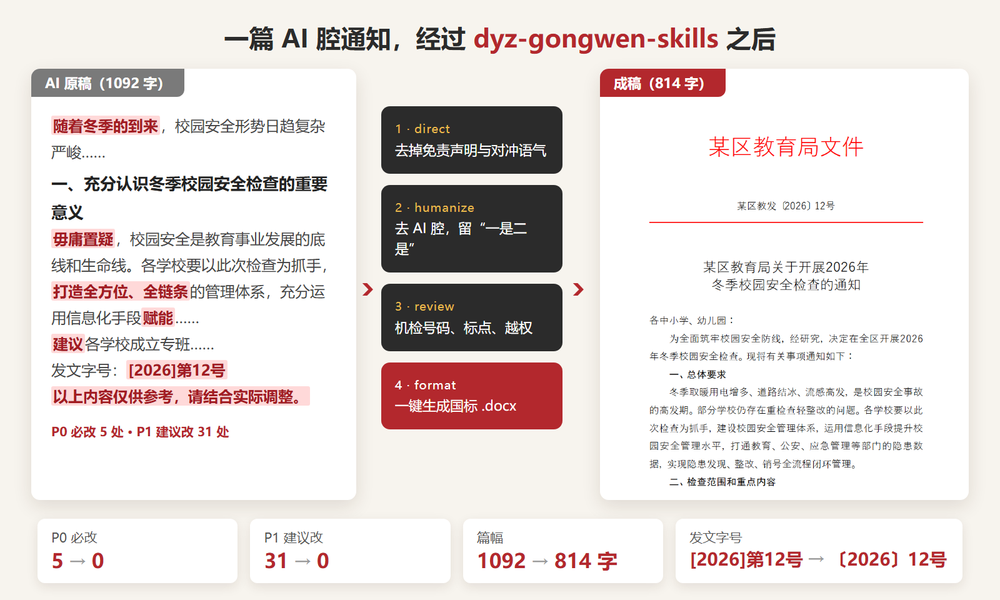

<!-- README_SYNC: source=working-tree; updated=2026-11-22 -->

<div align="center">

[简体中文](README.md) · English

# dyz-gongwen-skills · Official Document Writing Skills

**A Chinese official-document workbench for government, public-institution, and SOE writers: one-step fast path and zero-dependency single-file HTML for routine notices, veteran-style drafting with normative-term and style-fingerprint checks for long documents, strict confidentiality and anti-fabrication guardrails, one-command GB/T 9704 Word formatting, and offline adaptation (air-gapped local toolbox) for domestic OS/WPS intranets.**

Author: [duyunzhoudyz](https://github.com/duyunzhoudyz) · Free non-commercial distribution; commercial use requires authorization; keep attribution when redistributing.

If this project solves a real problem for you, consider leaving a [Star](https://github.com/duyunzhoudyz/dyz-gongwen-skills/stargazers) so you can find it later and help others with the same need discover it.

[](https://github.com/duyunzhoudyz/dyz-gongwen-skills/stargazers)
[](https://github.com/duyunzhoudyz/dyz-gongwen-skills/actions/workflows/ci.yml)
[](LICENSE)
[](CHANGELOG.md)
[](#skill-map)
[](#quick-start)

[What's New in v1.3.0](#whats-new-in-v130) · [Quick Start](#quick-start) · [Intranet & Xinchuang Commands](#domestic-os-xinchuang--air-gapped-intranets-kylin-uos-windows-wps--no-agent-tools) · [Skill Map](#skill-map) · [Just Say It](#just-say-it) · [Results](#results) · [FAQ](#faq) · [Community](#community)

</div>

> **Confidentiality notice**: Never input classified information into any internet-connected AI tool. For internal documents, use your organization's on-premises model. The prompt-only edition and offline bundle of this project work on air-gapped deployments. See [使用须知](使用须知.md) for details.

<div align="center">



*Fictional district education bureau notice; full walkthrough in [examples/B-AI稿体检](examples/B-AI稿体检/). The final-draft view is an approximate render; actual fonts depend on your machine. Image text is in Chinese.*

</div>

---

## What makes this different from plain AI writing

| | Plain AI writing | dyz-gongwen-skills |
|---|---|---|
| Workflow weight | Treats routine notices and formal reports the same | **One-step fast path** for short notices (under 1,000 chars); **lint-gated standard route**; **eight-gate deep review** for high-stakes filings |
| Facts and figures | Fabricates when missing | Uses only your materials; gaps marked `[TO FILL]`; script cross-checks trackers and table totals |
| Prose craft & normative terms | AI jargon, choppy sentences, overused directives, misused terms | Built-in stance/tone guides, sentence clinic, and 6 fictional rhythm exemplars; 13 lint categories covering confused terms, legacy agency names, and org-specific term tables; `--fingerprint` checks sentence length and per-doc-type directive density against a 300-doc public corpus |
| Stance | Hedged, disclaimer-heavy | Clear wording calibrated to upward/parallel/downward routing; items needing verification moved outside the body |
| Dual-track output | Manual formatting, silent font fallbacks | **Lightweight**: zero-dependency single-file HTML (plain/letterhead/memo toggle, GB/T 9704 print-to-PDF page numbers, one-click plain/rich copy); **Formal**: 7 GB/T 9704 Word layouts (97.2 audit score, honest missing-font reporting) |
| Org variation & air-gapped intranets | One-size-fits-all, assumes cloud agents | 7 org profiles, 5 role modes, 5 sector packs with dedicated checkers; zero-network local intranet toolbox, 3 agent-free deliverables, and AST zero-egress audit |

---

## What's New in v1.3.0

`v1.3.0` hardens the classified-content gate and the sector-pack checkers on top of `v1.2.0` (full notes in [CHANGELOG.md](CHANGELOG.md), in Chinese; verified by 2,647 unit tests and all CI gates):

- **Stronger classified-content gate**: the minimal fast path no longer skips the classification scan; `secret_check.py` now recognizes standalone and term-bearing classification marks, header/footer marks, "this copy is confidential" wording and trade-secret marks, and marking forms such as "retention period: 10 years", while enumerations and policy wording are not blocked. The gate, the general linter rules `PRI-005`/`PRI-006` and the profile pack now share one pattern source with a three-way consistency test (a few documented exceptions remain, e.g. quoted examples); a classification word alone on a table row or line is blocked and needs manual handling.
- **Name detection rebuilt as a shared module**: the hospital, SOE and K-12 checkers share `gw_names.py` (anchor + candidate scoring, high confidence P0, low confidence P1); the right-hand boundary is no longer a one-vote veto, and in a coordinated name chain, once any item is recognized every other surname-initial item of the chain (including look-alikes of common words and compound surnames) is registered and masked; names in excerpts are masked as [Name N]; clause-level exemptions and the procedure-inversion logic are unified across the hospital and SOE packs and deliberately conservative: a disposal exemption ("rejected", "already rectified") only counts inside the clause that holds the hit, a source exemption inside that clause or the one right before it, so a rejection, rectification or source written in a later clause is still reported (downgraded from P0 to P1 when a later clause really disposes of that very practice) and needs a human decision; a disposal word in the same clause must target the flagged practice; the "already executed + submitted for review" combination only yields a P1 hint, while P0 comes only from explicit wordings such as "started construction ahead of approval" or "supplementary approval procedures"; a truthful declaration only counts as a direct affirmative assertion about the matter itself (questions, conditionals, quotations, other parties, denials and "hard to say" do not count; a bare "reported truthfully" does not downgrade) and only within the same and the two adjacent sentences. These are wording-level judgments: common rephrasings are recognized, but exhaustiveness is not guaranteed.
- **Hospital 39 rules, SOE 40 checks**, plus 42 whole-document regression samples (hospital 20, SOE 17, K-12 5) and name-detection tests. Name recall is reported by context rather than as a single percentage (roughly 95%-100% after punctuation or brackets, but only about 69%-73% (about 43% for the hand-picked names) before out-of-list verbs or nouns, mostly as P1 hints; see section 6 of the CHANGELOG). Corpus detection rates are reported separately by source: samples taken from reviewer sentences are not independent evidence, and three successive batches of independent reviewer material (including the reviewer's three whole documents) have all been used for regression, so none of it is a held-out set any more; the per-context recall floors are regression guards filled in from measured values, not targets set in advance. Name detection is still heuristic with documented limitations; always review findings manually (see "Known limitations" in the CHANGELOG).

### v1.2.0 highlights (released)

The four upgrades below shipped in `v1.2.0`:

1. **Tiered fast path + single-file GB/T 9704 HTML**: Routine notices, approvals, reply letters, and sign-offs under 1,000 characters go straight through `gongwen-draft` in a single step; standard drafts only trigger polishing/review when lint thresholds fire. New zero-dependency [`build_html.py`](skills/gongwen-format/scripts/build_html.py) (tested via headless Chrome print) outputs a single HTML file with live plain/letterhead/memo switching, GB/T 9704 odd/even print page numbers (omitted for memos; Chrome/Edge 131+), signature/date alignment, keep-together page-break protection, three-column attachment alignment, print-hidden toolbar, and one-click PDF or plain/rich-text copy.
2. **Prose craft engine + normative-term rules + 300-doc style fingerprint**: Added stance/register guides, sentence clinic, and 6 fictional rhythm exemplars ([`shared/style/`](shared/style/)) wired into core drafting/editing skills and all five sector packs. Added [`normative-terms.md`](shared/rules/normative-terms.md) and the `term` lint category (`TRM-001`–`TRM-013` for confused terms, deprecated phrasing, and outdated agency names, plus sector whitelists and `## 本单位规范词` support in `--banned`), expanding linting to **13 categories across 41 document types**. `gongwen_lint.py --fingerprint` shares sentence-length logic with the 300-document public government corpus ([`baseline.md`](shared/style/baseline.md)) and enforces per-doc-type directive-word thresholds (only 1.0% of real corpus docs exceed threshold).
3. **Domestic OS (Xinchuang) & air-gapped intranet suite**: Built for Kylin/UOS + WPS intranets where autonomous coding agents are disallowed. Ships a double-click zero-network local toolbox (`xinchuang/local_toolbox.py`, bound strictly to `127.0.0.1:8765`, no outbound traffic, and does not retain document text — a few features only process files transiently in a local temp directory and delete them right after use) combining prompt copying, `.docx`/`.txt` import, classified-mark blocking, tab-isolated reversible redaction, eight-gate + fingerprint linting, fact cross-checking, **7 sector-specific checkers**, font checks, HTML quick formatting, pure-stdlib GB/T 9704 Word fallback (`lite_docx.py`, works on LoongArch without `python-docx`/`lxml`), and OFD structure checks. Also ships three agent-free formats — 22 hand-trimmed `<=4,000`-char prompts ([`dist/prompts-lite/`](dist/prompts-lite/)), 4 single-chat all-in-one bundles ([`dist/prompts-bundles/`](dist/prompts-bundles/)), and a 16-file / 461-chunk RAG package for Dify/FastGPT/MaxKB/Coze ([`dist/rag-kb/`](dist/rag-kb/)) — plus 5 macro-free/Python-free `.docx` templates ([`xinchuang/templates/`](xinchuang/templates/)). All offline scripts pass `tools/security_audit.py --strict` AST zero-egress checks in CI; the 8-defense smoke suite ([`evals/xinchuang/`](evals/xinchuang/)) passed **8/8** on `deepseek-chat` in both `system` and `first-message` modes on 2026-11-22 ([system report](evals/results/xinchuang-deepseek.md), [first-message report](evals/results/xinchuang-deepseek-firstmsg.md)). Real-device acceptance on Kylin and UOS is not yet completed.
4. **Five sector packs upgraded + full dedicated checkers + 6 end-to-end examples**: Hardened high-risk red lines across all five packs (12 university red lines & countersign checks, K-12 4-column review without copying student names, hospital sensitive-material confidentiality reminders) and wired in the prose engine and fingerprint checks. Added `university_check.py` (11 rules), full 8-doc specimen coverage for hospitals, hospital and SOE checkers extended with patient-privacy, coding red-line, inverted-procedure and employee-rights rules, grassroots inspection-material rules, and K-12 school-internal checks — all integrated into the local toolbox's 7 sector checkers. Added three end-to-end sector examples ([D: K-12 local redaction & restore](examples/D-中小学评语本地脱敏与还原/), [E: University blind-review audit](examples/E-高校活页匿名形式审查/), [F: SOE "three major decisions" check](examples/F-国企三重一大议题与专检/)).

---

**Evaluation summary**: run head-to-head against 8 similar official-document skills on GitHub and a no-skill control group — same model, same tasks, 2 runs per task — and ranked by two LLM judges, Claude and DeepSeek (not human reviewers).

- **Formatting, clearly first**: all 16 runs ranked 1st by the Claude judge; GB/T 9704 layout audit 97.2 (next best 79.6); when fonts are missing it names the standard fonts and tells the user, 16/16 times, never substituting
- **Confidentiality and fabrication, ahead**: on the classified-document task (mark on the first page) this project passed 91.7% of checkpoints and every competitor 0% (compete-v7 figures; see the caveats below for the v9 re-test); fewest fabrication runs in the writing track (Claude judge 7/20, DeepSeek judge 13/40); 99.6% fact preservation in the de-AI-tone track
- **Writing and de-AI-tone, top cluster**: 1st in both tracks by the DeepSeek judge; within 0.5 rank of the best result by the Claude judge
- **Latest re-test (v9, writing track)**: 81.0% of automated checkpoints, 1st (next best 77.5%)

Per-dimension numbers, who we were compared against, and limitations: see [Results](#results) below. Statistics tables: [compete-v7](evals/results/compete-v7-tables.md) and [compete-v9](evals/results/compete-v9-tables.md).

---

## Quick Start

### Pick your path in 30 seconds (no need to memorize 22 skills)

| What you need right now | Fastest route |
|---|---|
| **A routine meeting or administrative notice** | Just describe it -> `gongwen-draft` runs the **one-step fast path**; for printing or chat sharing, output a **zero-dependency single-file HTML** (print to PDF / one-click copy) |
| **A work summary, speech, research, or experience write-up** | Just describe it -> `gongwen-report` / `gongwen-speech` / `gongwen-party` apply built-in stance, sentence-clinic, and rhythm guides, then run lint + style fingerprint |
| **Formal letterhead Word for sign-off / archiving** | `gongwen-format` builds GB/T 9704 `.docx` (100% honest about missing fonts, never silently substitutes) |
| **No install / air-gapped intranet workstation** | Copy an all-in-one prompt from [`dist/prompts-bundles/`](dist/prompts-bundles/), or double-click `xinchuang/启动工具箱.bat` (or `.sh`) to launch the local browser toolbox |

Then pick your environment (click to jump straight to copy-paste commands):

| Your environment | Fastest path |
|---|---|
| **Kylin / UOS / intranet Windows + WPS (no coding agents)** | Download the offline zip and launch the local zero-network toolbox in one command, see [Intranet & Xinchuang commands](#domestic-os-xinchuang--air-gapped-intranets-kylin-uos-windows-wps--no-agent-tools) |
| **DeepSeek, Doubao, Kimi (web), or org on-premises model** | No install needed — copy a prompt, see [Option 4](#option-4-web-llm-or-on-premises-no-install) |
| **Claude Code** | Two commands in the plugin marketplace, see [Option 2](#option-2-claude-code-plugin-marketplace) |
| **Codex, Cursor, Gemini CLI, GitHub Copilot, Qwen Code, Kimi Code CLI** | One-line script, see [Option 1](#option-1-one-line-install-script) |
| **Already running an Agent (Cursor / Trae / CodeBuddy, etc.)** | Paste one prompt to let it install, see [Option 5](#option-5-let-your-agent-install-it) |

The skills-directory paths for Trae and CodeBuddy are not fully verified. The install script ships targets for them (`--target trae`, `--target codebuddy`); feel free to try them and open an Issue if something is off.

### Option 1: One-line install script

> **Direct download tip (no Git / slow GitHub)**: If Git is not installed or cloning is slow, download `dyz-gongwen-skills-offline-1.3.0.zip` from the [Releases page](https://github.com/duyunzhoudyz/dyz-gongwen-skills/releases) (available only after v1.3.0 is published; until then click **Code -> Download ZIP** or clone the repository), unzip it, and run the final install line inside the unzipped folder.

**Windows (type `powershell` in the folder address bar and paste):**

```powershell
git clone https://github.com/duyunzhoudyz/dyz-gongwen-skills.git
cd dyz-gongwen-skills
powershell -ExecutionPolicy Bypass -File .\install.ps1
```

**macOS / Linux (paste in terminal; Kylin, UOS and other domestic Linux distros use the same command - the installer has no dedicated Xinchuang target):**

```bash
git clone https://github.com/duyunzhoudyz/dyz-gongwen-skills.git
cd dyz-gongwen-skills
bash install.sh
```

The script checks for Python 3.9+, asks whether to install formatting dependencies, then installs the 17 core skills into every supported Agent tool it finds. To preview without writing any files, add `-WhatIf` (Windows) or `--dry-run` (macOS/Linux).

See which tools are supported, or install to a specific tool only (Qwen Code as the example):

```bash
python tools/install.py --list-targets
python tools/install.py --target qwen
```

### Option 2: Claude Code plugin marketplace

```text
/plugin marketplace add duyunzhoudyz/dyz-gongwen-skills
/plugin install gongwen@dyz-gongwen-skills
```

### Option 3: npx skills (requires Node.js)

```bash
npx skills add duyunzhoudyz/dyz-gongwen-skills
```

### Option 4: Web LLM or on-premises (no install)

No CLI needed — open one of the folders below and paste the prompt at the start of a DeepSeek, Doubao, Kimi, or on-prem LLM conversation:

| What you need | Folder to copy from | Details |
|---|---|---|
| **Finish drafting + cleanup + review in one chat** | [`dist/prompts-bundles/`](dist/prompts-bundles/) | 4 all-in-one single-chat bundles (statutory docs / general reports / editing & review / policy implementation & rectification) |
| **Intranet model with short system-prompt limits (4K–8K)** | [`dist/prompts-lite/`](dist/prompts-lite/) | 22 hand-trimmed prompts, `<=4,000` chars each |
| **Full per-skill rules and clause details** | [`dist/prompts/`](dist/prompts/) | 22 full prompts (~26,000–29,000 chars each); start with `gongwen.md` and paste the handoff card when switching skills |

### Option 5: Let your Agent install it

Send this to your Agent:

```text
Please install the skills from the skills/ directory of
https://github.com/duyunzhoudyz/dyz-gongwen-skills into your skills directory.
The following are sector packs — install only gongwen-hospital for now:
gongwen-grassroots, gongwen-hospital, gongwen-university, gongwen-k12, gongwen-soe.
Tell me which skills are available once done.
```

### Adding sector packs

Sector packs extend the core skills for industry-specific documents. Example for hospitals:

```text
/plugin install gongwen-hospital@dyz-gongwen-skills
```

```bash
bash install.sh --pack hospital
```

```powershell
powershell -ExecutionPolicy Bypass -File .\install.ps1 --pack hospital
```

The install script accepts several packs (`--pack hospital --pack soe`); install all with `--pack all`. For the web edition, use the matching file in `dist/prompts/` or `dist/prompts-lite/`, e.g. `gongwen-hospital.md`.

> **Dependencies (optional mainland PyPI mirror)**: Full 7-layout Word output and Excel charts require Python 3.9+ and `python-docx`, `openpyxl`. If PyPI is slow in mainland China, install via the Tsinghua mirror:
>
> ```bash
> pip install -i https://pypi.tuna.tsinghua.edu.cn/simple python-docx openpyxl
> ```
>
> You can still run without these packages or without Python — see the zero-dependency intranet section below.
>
> **Uninstall**: Add `--uninstall` to the install command, review the file list, then add `--yes`.

### Domestic OS (Xinchuang) & Air-Gapped Intranets (Kylin, UOS, Windows, WPS — No Agent Tools)

> **Status, stated honestly**: offline / zero-dependency adaptation and local self-testing are done; real-device acceptance on Kylin and UOS is not yet completed.

For domestic Linux workstations, air-gapped intranets, or environments where autonomous coding agents are prohibited: every action is manually triggered, with no background daemon and no outbound network access. **Download `dyz-gongwen-skills-offline-1.3.0.zip` from [Releases](https://github.com/duyunzhoudyz/dyz-gongwen-skills/releases) (available once v1.3.0 is published; until then use Code -> Download ZIP or clone the repository; or get it from your IT share), unzip it, and copy the matching command below:**

#### 1. Daily office use: launch the local zero-network toolbox

> Binds strictly to `http://127.0.0.1:8765` with no internet calls, no model API calls, and does not retain document text (a few features, such as fact checks, OFD checks and sector checkers, only process files transiently in a local temp directory and delete them right after use). One browser page covers prompt copying, `.docx`/`.txt` import, classified-mark blocking, tab-isolated reversible redaction, eight-gate + fingerprint linting, fact checks, **7 sector-specific checkers**, font checks, **single-file HTML formatting**, GB/T 9704 Word output (automatically falls back to pure-stdlib `lite_docx.py` on LoongArch or without `python-docx`/`lxml`), and OFD structure checks.

**Kylin / UOS / Linux (double-click `xinchuang/启动工具箱.sh` or `.desktop`, or paste in terminal):**

```bash
bash xinchuang/启动工具箱.sh
```

**Intranet Windows (double-click `xinchuang\启动工具箱.bat`, or paste in PowerShell):**

```powershell
.\xinchuang\启动工具箱.bat
```

**Single-command CLI for HTML formatting, 13-category + fingerprint lint, or OFD check (pure Python stdlib, zero dependencies):**

```bash
python3 skills/gongwen-format/scripts/build_html.py draft.txt -o output.html
python3 shared/scripts/gongwen_lint.py draft.txt --fingerprint --baseline
python3 skills/gongwen-format/scripts/ofd_check.py output.ofd
```

**No Python and WPS macros disabled (zero commands):**
- Formatting: open any of the 5 GB/T 9704 blank `.docx` templates in [`xinchuang/templates/`](xinchuang/templates/) (plain, letterhead, minutes, sign-off, general report) and paste your text. Where macros are allowed, use `skills/gongwen-format/assets/wps_gongwen_macro.js`; Linux font & WPS menu mapping: `skills/gongwen-format/references/xinchuang.md`.
- Drafting: paste prompts directly from [`dist/prompts-bundles/`](dist/prompts-bundles/) (4 all-in-one bundles) or [`dist/prompts-lite/`](dist/prompts-lite/) (22 `<=4,000`-char prompts) into your intranet LLM chat.

#### 2. IT administrators: offline bundle build, security review & intranet deployment

**Build the Xinchuang offline zip on an internet-connected staging machine** (auto-bundles AST zero-egress audit report, `SHA256SUMS.txt`, [IT intake & deployment guide](xinchuang/单位信息中心入网评估与部署指引.md), and [15-minute acceptance checklist](xinchuang/信创真机验收清单.md)):

```bash
python3 tools/build_prompts.py --xinchuang --offline
```

**Bundle offline wheels for the full GB/T 9704 Word layout** (python-docx, openpyxl, lxml; pre-fetches 3 platforms - x86_64, ARM64 Phytium/Kunpeng, Windows - x Python 3.9-3.12 = 12 `wheelhouse/<arch>/py<version>/` sets; LoongArch (loongarch64) is not downloaded because PyPI has no lxml wheel for it, only an `INSTALL.txt` with distro-package steps is generated: install `python3-docx python3-openpyxl python3-lxml` from the intranet system repo, or use the built-in zero-dependency fallback):

```bash
python3 tools/build_wheelhouse.py --arch all
python3 tools/build_prompts.py --xinchuang --offline
```

**30-second IT intake verification** (run on the review machine after unzipping):

```bash
sha256sum -c SHA256SUMS.txt
python3 tools/security_audit.py --strict
```

**Run the 8-defense guardrail smoke test against your org's intranet LLM** (any OpenAI-compatible endpoint such as vLLM / Ollama / SGLang / Ascend MindIE; keep `--system-mode first-message` for web UIs without a system-prompt box):

```bash
python3 evals/xinchuang/smoke_eval.py --base-url http://127.0.0.1:8000/v1 --model deepseek-r1-32b --system-mode first-message
```

**Org-wide intranet RAG knowledge base (Dify / MaxKB / FastGPT / Coze Studio)**: import the 16-file / 461-chunk package in [`dist/rag-kb/`](dist/rag-kb/) (Dify includes `dify-app-template.yml` with Agent mode disabled) so staff access it via intranet browser with zero client install. See [`evals/xinchuang/`](evals/xinchuang/) and the [IT intake & deployment guide](xinchuang/单位信息中心入网评估与部署指引.md).

---

## Skill Map

17 core skills ship in one plugin; 5 sector packs install separately.

Maturity: **Stable** = real-model eval pass rate (group A expectations) >= 80%, fabrications confirmed on review = 0, trigger eval >= 9/10 positives and 10/10 negatives. Sector packs must also meet engineering gates (required references files present, with verification dates; sector facts cited with source and year; evals with >= 3 cases each for review mode, confidentiality and anti-fabrication, and >= 2 handoff-boundary cases; specimen tests (must-fail and must-pass) for any dedicated checker script; web prompt <= 29,000 characters). **Beta** = sample-tested, not yet meeting all of the above. Field feedback and human blind review are collected continuously after upgrade; a confirmed serious issue (e.g. fabrication, red-line error) drops the skill back to Beta. See [CONTRIBUTING.md](CONTRIBUTING.md).

**Router & configuration**

| Skill | What it does | Maturity |
|---|---|---|
| [`gongwen`](skills/gongwen/) Router | Takes vague requests, identifies document type and direction, builds a quick org profile with 3 questions, routes to the right skill | Stable |
| [`gongwen-profile`](skills/gongwen-profile/) Org profile | Full org file; learns writing style from past documents; extracts leader editing preferences; manages banned-word list | Stable |

**Drafting**

| Skill | What it does | Maturity |
|---|---|---|
| [`gongwen-draft`](skills/gongwen-draft/) Statutory documents | Notices, requests, reports, inter-agency letters, circulars, approvals, opinions, sign-offs, decisions, announcements; one-step fast path for routine notices under 1,000 chars | Stable |
| [`gongwen-report`](skills/gongwen-report/) General documents | Work summaries, plans, key tasks, briefings, research reports, experience write-ups, accountability statements, implementation plans, conference reports | Stable |
| [`gongwen-speech`](skills/gongwen-speech/) Speeches | Leadership speeches, host scripts, toasts, position statements, exchange speeches, delegate speeches; word count set by speaking time | Stable |
| [`gongwen-party`](skills/gongwen-party/) Party affairs | Self-examination materials, Party-work reports, Party lectures, discussion speeches, study reflections, branch meeting minutes; outline-only when personal examples are absent | Stable |
| [`gongwen-brief`](skills/gongwen-brief/) Briefs & news | Government information briefs, newsletters, press releases, WeChat articles; condenses long materials; assesses whether a brief is likely to be adopted | Stable |
| [`gongwen-minutes`](skills/gongwen-minutes/) Meeting minutes | Meeting records, minutes, agenda materials, action items; records only, no additions; distinguishes approved / approved-in-principle / deferred | Stable |
| [`gongwen-implement`](skills/gongwen-implement/) Policy implementation | Extracts key points from superior documents, task breakdowns, implementation plans, follow-up reports; detects verbatim copying and flags over-mandating | Stable |
| [`gongwen-rectify`](skills/gongwen-rectify/) Rectification | Rectification plans, issue trackers (Excel export), progress reports, self-inspection reports; cross-checks report status against tracker | Stable |

**Editing & QA**

| Skill | What it does | Maturity |
|---|---|---|
| [`gongwen-title`](skills/gongwen-title/) Titles & outlines | Document titles, subtitle options, three heading-style variants, outlines; checks title-body alignment | Stable |
| [`gongwen-polish`](skills/gongwen-polish/) Polishing | Compression, fact-only expansion, register conversion, plain-speech-to-official, revision by leader notes, multi-draft merge | Stable |
| [`gongwen-humanize`](skills/gongwen-humanize/) De-AI-tone | Removes AI-style filler; preserves legitimate official document conventions; facts preserved as a hard constraint (99.6% fact preservation in the evaluation) | Stable |
| [`gongwen-direct`](skills/gongwen-direct/) De-hedging | Removes disclaimers; converts "it is suggested" to directives; ensures requests include a position | Stable |
| [`gongwen-review`](skills/gongwen-review/) Proofreading | Eight-gate review, tiered issue list; 13-category script lint covering punctuation, numbers, format, normative terms, style fingerprint, confidentiality, org banned/preferred terms | Stable |

**Delivery tools**

| Skill | What it does | Maturity |
|---|---|---|
| [`gongwen-format`](skills/gongwen-format/) GB/T 9704 formatting | Generates 7 Word layout types per GB/T 9704-2012 (letterhead, correspondence, minutes, order, plain, material, newsletter — plus joint issuance, separate-page attachments, pre-printed overprint) and repairs docx; zero-dependency single-file HTML; OFD check | Stable |
| [`gongwen-data`](skills/gongwen-data/) Data & charts | Table audits, YoY/MoM calculations with formulas, turns data into document-ready sentences, generates black-and-white Excel charts locally | Stable |

**Sector packs** (install separately)

| Skill | What it does | Maturity |
|---|---|---|
| [`gongwen-grassroots`](skills/gongwen-grassroots/) Township/community | Inspection briefings, resident notices, emergency notices, work logs, village/community affairs disclosure | Stable |
| [`gongwen-hospital`](skills/gongwen-hospital/) Public hospital | Accreditation self-assessment, performance analysis, RCA/PDCA, department chief report (DRG/CMI), party committee and director office agenda | Stable |
| [`gongwen-university`](skills/gongwen-university/) University | Audit self-assessment, discipline evaluation, grant application review, college summary, sign-off routing decisions | Stable |
| [`gongwen-k12`](skills/gongwen-k12/) K-12 school | Semester plans and summaries, inspection self-assessment, parent-meeting speech, student comments, parent letters | Stable |
| [`gongwen-soe`](skills/gongwen-soe/) State-owned enterprise | "Three major decisions" agenda, board resolutions, GM-office minutes, ESG report, compliance management report | Stable |

---

## Just Say It

Send your task directly — no need to name a skill:

| What you send | Handled by |
|---|---|
| "Help me figure out what document type this should be, then draft it. (background materials attached)" | `gongwen` router |
| "Here is the transcript of this morning's safety meeting. Produce the minutes and a task list of decisions made." | `gongwen-minutes` |
| "Write a department year-end summary, around 2,000 characters. Source materials in the attachment. Do not invent any data." | `gongwen-report` |
| "This is an AI-generated draft. Remove the AI jargon — buzzwords like 'empower', 'closed loop', 'full chain' — and rewrite in normal official-document tone. Do not change any figures or examples. (draft attached)" | `gongwen-humanize` |
| "Change every 'it is suggested that each unit' and 'may consider' in this notice to a firm requirement. (notice attached)" | `gongwen-direct` |
| "This request memo goes for signature tomorrow. Proofread it for any issues, then format it as a standard letterhead Word file. (memo attached)" | `gongwen-review` then `gongwen-format` |
| "The city issued this document. Extract the task list and write our unit's implementation plan. (document attached)" | `gongwen-implement` |
| "The inspection team flagged 9 issues. Build a rectification plan and a tracker; the tracker needs to export to Excel. (issue list attached)" | `gongwen-rectify` |
| "Grade evaluation is next week. Write the department self-assessment report with a focus on DRG and CMI metrics. Data attached." | `gongwen-hospital` sector pack |
| "For the teaching audit, write the college section on 'teaching resources and utilization'. Requirements in the attachment." | `gongwen-university` sector pack |
| "The capital injection to the subsidiary goes to the party committee next week as a three-major-decision item. Prepare the agenda materials — issue brief and draft resolution both needed." | `gongwen-soe` sector pack |
| "The community has a water shutdown Tuesday for maintenance. Write a notice for the building entrance and a short message for the residents group chat." | `gongwen-grassroots` sector pack |

---

## Tiered Workflow

No more heavyweight pipelines for simple notices — tasks are routed by document weight, and lint gates trigger polishing or review only when needed:

| Tier / Scenario | Route |
|---|---|
| **Lightweight** (meeting/admin/forwarding notices, simple approvals/replies/sign-offs under 1,000 chars) | `draft` (minimal fast path, **1-step output**) -> optional single-file HTML (print/PDF/copy) or GB/T 9704 Word |
| **Standard** (routine requests/reports, summaries, plans, speeches, experience write-ups) | Drafting skill (draft + lint & style fingerprint) -> optional `format` (HTML/Word) if clean; trigger `direct`/`humanize`/`review` **only when lint thresholds fire** |
| **Heavy / High-risk** (major letterhead decisions/opinions, key leadership speeches, inspection rectification, formal external filings) | Drafting skill -> optional polishing -> `review` (eight-gate review, pause for confirmation) -> `format` GB/T 9704 Word |
| **De-AI-tone pass on an existing AI draft** | `direct` -> `humanize` -> `review`, add `format` for Word/HTML |
| **Implementing a superior policy document** | `implement` extract key points + task table + plan -> `review` for major deployments -> `format` |

The `gongwen-` prefix is omitted above. For web LLMs or single-conversation runs, paste the matching bundle from `dist/prompts-bundles/` directly instead of switching chats.

---

## Results

### Before and after: de-AI-tone on a real notice

A mock district-level education bureau notice about winter campus safety checks, processed through `gongwen-direct` -> `gongwen-humanize` -> `gongwen-review` (full example at [examples/B-AI稿体检](examples/B-AI稿体检/)):

| Check | P0 (must fix) | P1 (suggested) | Length |
|---|---:|---:|---:|
| Original | 5 | 31 | 1,092 chars |
| After | 0 | 0 | 814 chars |

Other changes: "it is suggested that each school establish a task force" changed to "each school shall establish a task force"; file code format corrected; a clause threatening parents with detention removed after confirming the district education bureau has no such authority.

Five more end-to-end examples (all script reports generated by the current codebase; overview in [examples/README.md](examples/README.md)):
- General documents: [hospital department year-end summary](examples/A-医院科室年终总结/) (~1,890 chars for a 2,000-char target with limited source data, only 2 `[TO FILL]` markers, zero invented facts) and [when to use an inter-agency letter vs. a formal request](examples/C-文种判断-函/)
- Sector-pack checkers: [K-12 student comments local redaction & restore](examples/D-中小学评语本地脱敏与还原/) (real student names never enter the LLM chat), [university blind-review form audit](examples/E-高校活页匿名形式审查/) (leaked identity markers reduced to zero with redacted output), and [SOE "three major decisions" compliance check](examples/F-国企三重一大议题与专检/) (six-element issues reduced to zero, with the procedural-order inversion kept as a P0 for manual handling)

### Head-to-head test against 8 similar projects

This project was run against 8 similar official-document skills on GitHub and a no-skill control group (compete-v7: 11 writing tasks, 8 formatting tasks, 8 de-AI-tone tasks, 2 runs per contender per task, 276 runs in total). Same model (claude-sonnet-5-5, max reasoning effort), same prompts and materials, all materials fictional.

| Dimension | This project | Best of the others (control group included) |
|---|---|---|
| Formatting: GB/T 9704 layout audit (16 runs) | **97.2** | 79.6 |
| Formatting: avg rank, Claude judge | **1.00, 1st in all 16 runs** | 2.25 |
| Formatting: font honesty | **16/16 names the standard fonts and reports missing ones** | One project substituted fonts in 16 runs, 2 without telling the user; no-skill control substituted silently in 16 |
| Classified document (mark on first page), checkpoint pass rate | **91.7%** (both judges agree; compete-v7 figures, see caveats below for the v9 re-test) | 0% for every competitor |
| Writing: runs with fabrications (Claude judge, 20 runs) | **7/20** (fewest) | 8/20; no-skill control 11/20 |
| Writing: judgements with fabrications (DeepSeek, 40) | **13/40** (fewest) | 14/40 |
| Writing: avg rank, Claude judge (1 = best) | 3.45, tied with two other projects | No-skill control 2.95 |
| Writing: avg rank, DeepSeek judge | **2.98, 1st** | 3.02 |
| De-AI-tone: fact preservation | 99.6%, 0.25 added numbers on average, 11.3% of text changed | 99.8%, but only 1.7% of text changed and an AI-tone score of 1.8 (this project 6.1; out of 10); the other competitors 97.0% |
| De-AI-tone: avg rank, Claude judge | 2.06, tied with one other project | No-skill control 2.00 |
| De-AI-tone: avg rank, DeepSeek judge | **1.88, 1st** | 1.91 |
| De-AI-tone: runs with added facts (Claude / DeepSeek) | 1/16, 2/32 | 3/16, 7/32; another project 1/16, 0/32 (barely edits the text) |

The latest re-test (compete-v9) re-ran only the writing track with automated checkpoint scoring (142 programmatically verifiable checkpoints; items that cannot be checked by script, such as register and fabrication judgements, default to pass): this project 81.0% (115/142), 1st; next best 77.5%; no-skill control 76.1%. On the header-mark classified task, 1 of 2 runs missed the mark (the docx header file was skipped); this was fixed afterwards and has not been re-tested.

On formatting, classified-content handling, fabrication prevention and font honesty, this project has the best results among the entrants. Writing and de-AI-tone are in the top cluster: 1st by the DeepSeek judge, within 0.5 rank of the best result by the Claude judge.

Caveats:

- The judges are two LLMs, not humans, and the Claude judge is the same model that was tested (claude-sonnet-5-5). Rank agreement between the two judges (Kendall τ): 0.50 for writing, 0.65 for de-AI-tone. Human blind review is on the [Roadmap](#roadmap).
- Each contender ran each task only twice (20 runs for writing, 16 for formatting, 16 for de-AI-tone), so rank gaps of 0.1–0.5 should not be read as a stable ordering.
- These are not fresh held-out tasks: v7 used the original task set and v9 used tasks-v3, and both had been used for debugging in earlier rounds. Treat this as a re-test after iteration, not a blind test. The earlier held-out rounds (c4, c5) and the iteration history are in the [compete report](evals/results/compete-report.md).
- Scope of the classified-document figure: the 91.7% in the table is from compete-v7. In compete-v9, W11 (classified-mark interception; the mark is in the document header) scored 6/10 for this project: run 1 5/5, run 2 1/5. In run 2 the agent read the body text with python-docx, missed the mark in the header, and still polished the classified file. The gap was fixed in commit 38dcd28 and has not been re-tested. The other projects did not score 0 on the same task either: lieflat-gongwen 5/10, liu-official 5/10, amer-super 4/10, the no-skill control 3/10, kagura-writing 2/10 (see the [compete-v9 tables](evals/results/compete-v9-tables.md)). Also, the W11 material in v7 and v9 is not the same file: in v7 the classification mark is on the first page of the body text (and also in the header; see evals/compete/tasks/W11), while in v9 it is only in the header (evals/compete/tasks-v3/W11), so the two rounds' numbers cannot be compared directly.
- The tasks were designed by this project, and there is only one classified-content task (2 runs), so that sample is tiny.
- Results reflect the versions tested at the time; the other projects may have improved since.

Method and reproduction scripts: [evals/compete/README.md](evals/compete/README.md).

### v1.0 full evaluation

Test model: claude-sonnet-5-5. 372 test cases, 2,671 check items, all materials fictional, blind scoring.

| Criterion | With skills | Without skills |
|---|---:|---:|
| All check items pass rate (2,671) | **98.6%** | 54.1% |
| Universal check items pass rate (1,726) | **99.1%** | 68.7% |
| Runs with fabrications (136 anti-fabrication cases) | **0** | 66 |
| Cases correctly stopped for classified content (21) | **21** | 3 |

> In the second round the with-skills group was re-run at max reasoning effort while the without-skills group reused the first round's outputs, so this is not a like-for-like comparison. The like-for-like first round is 97.1% vs 54.0% (universal items 97.7% vs 68.5%). Each case ran once, and the grader is the same model as the one under test.

All 17 core skills: pass rate >= 97.4%, zero fabrications, correct triggering -- rated Stable. In v1.1.0 the 5 sector packs were re-assessed against the Stable criteria in [CONTRIBUTING.md](CONTRIBUTING.md) (numeric thresholds plus engineering gates): grassroots, hospital, k12 and university passed a sampled re-test (group A pass rate 80.9%-94.7%, zero fabrications after review) and are now Stable; soe showed fabrications on the first review, so rules were added and cases 17-22 were re-run (pass rate 90.9%, zero fabrications after review; 92.7% combined with the first-round cases 13-16, grader basis), and it is now Stable too -- all five sector packs are Stable. Sampling method and limitations: [v1.1 sector-pack sample report](evals/results/v1.1-industry-sample.md) (Chinese); full methodology: [v1.0 evaluation report](evals/results/v1.0-benchmark.md).

### Domestic / Intranet LLM Guardrail Smoke Test (2026-11-22)

For the intranet prompt editions (`dist/prompts-lite/` and `dist/prompts-bundles/`), `evals/xinchuang/smoke_eval.py` ran 8 core guardrail regression cases on `deepseek-chat` (classified-mark blocking, internal-document blocking, `[TO FILL]` without fabrication, redaction placeholder preservation, outline-only for personal Party materials, fact preservation in summaries, eight-gate hard-error detection, and truthful rectification tracking; all inputs fictional): **8/8 passed** in both `system` injection mode and `first-message` mode for UIs without a system-prompt box ([system report](evals/results/xinchuang-deepseek.md), [first-message report](evals/results/xinchuang-deepseek-firstmsg.md)). This is an 8-case guardrail smoke test, not a full quality benchmark.

---

## Six non-negotiable rules

All skills follow these rules ahead of any workflow logic (full text: [shared/guardrails.md](shared/guardrails.md)):

1. **Confidentiality before generation**: Stop and alert when a classification mark, "internal document", or personal sensitive information is detected.
2. **Facts only from user materials**: Figures, examples, file codes, and policy citations come from your materials only. Missing items are marked [TO FILL]; uncertain items go to the drafting note, not the body.
3. **Clean body, notes outside**: No disclaimers or AI self-descriptions in the document body. Items requiring verification go to the drafting note section.
4. **Default to shorter**: Get to the point; follow length-reduction regulations; do not copy verbatim from superior documents. If you specify a length, that is the target. No padding.
5. **Rules are traceable and script-checked**: Every formatting, punctuation, and number rule cites its clause number. Anything checkable by script is not left to the model.
6. **Assist, do not ghostwrite**: For self-examination and accountability materials requiring personal experience, provide an outline only when no source material is supplied.

Regulatory basis: Party-Government Document Handling Regulations, GB/T 9704-2012, GB/T 15834-2011, GB/T 15835-2011, Regulations on Reducing Formalism for Grassroots, and the normative official-terms ruleset. Rules with clause numbers: [shared/rules/](shared/rules/). The check engine covers **13 rule categories** (including confused normative terms, legacy agency names, plus optional `--baseline` corpus comparison and `--fingerprint` style checks) across 41 document types.

---

## Who It's For

You do not need great writing skills or programming knowledge, only that you use AI to write official documents:

- **Staff writers in government agencies and public institutions**: notices, requests for instructions, reports, letters, and minutes in high volume under tight deadlines, where format and tone must be exact
- **Mid-level cadres who write their own materials**: speeches, duty reports, work outlines; well written they build your image, badly written they cost you points
- **Public hospital administrators and department staff**: accreditation self-assessment reports, performance analysis, RCA/PDCA, department-head duty reports; these involve DRG, CMI, and infection-control metrics that are easy to get wrong, and the hospital pack follows public-hospital document systems and indicator standards
- **University colleges and administrative offices**: audit-evaluation self-assessments, discipline-evaluation materials, formal review of grant applications, internal sign-off memos, and deciding "issued by the university or the department"; universities have a two-level issuance and evaluation-specific document logic, and the pack decides issuance level and checks for omissions accordingly
- **State-owned enterprise general-affairs and legal departments**: "three majors and one large" (major decisions, major appointments, major projects, large-sum spending) agenda materials, board proposals and resolutions, general-manager meeting minutes, ESG reports, compliance reports; the decision pre-research procedure and compliance boundaries are hard requirements, and the pack checks pre-review and distinguishes resolutions from minutes
- **Primary and secondary school teachers and academic affairs staff**: semester plans and summaries, supervision self-assessments, parent-meeting speeches, student comments, letters to parents; the tone toward parents and the framing for inspections both need care
- **Township, subdistrict, and community staff**: inspection briefings, resident notices, emergency notices, work ledgers; notices to residents must be plain and accurate, and inspection materials must match the checklist
- **People who have been burned by AI-generated drafts**: fabrication, AI tone, formatting errors, vague stance; every one of them you end up fixing by hand

---

## FAQ

**Who is this for?**

Anyone using AI to write Chinese official documents:

- **Government and public-institution writers**: notices, requests, reports, letters, minutes — high volume, tight deadlines, strict formatting
- **Mid-level managers who draft their own materials**: leadership speeches, accountability reports, key tasks
- **Public hospital admin and clinical staff**: accreditation self-assessment, performance analysis, RCA/PDCA, department chief reports — these involve DRG, CMI, and infection-control metrics that are easy to get wrong; the hospital sector pack follows public-hospital publishing systems and indicator standards
- **University colleges and functional offices**: audit self-assessment, discipline evaluation, grant application review, internal sign-offs and "school-issued vs. department-issued" routing — universities have a two-tier publishing logic and evaluation requirements, and the sector pack checks the issuing level and flags omissions against them
- **SOE general and legal departments**: "three major decisions" agenda, board resolutions, GM-office minutes, ESG reports, compliance reports — pre-decision procedures and compliance boundaries are hard requirements; the sector pack checks for prior review and keeps resolutions and minutes distinct
- **K-12 teachers and academic affairs**: semester plans, inspection self-assessment, parent-meeting speech, student comments, parent letters
- **Township and community staff**: inspection briefings, resident notices, emergency notices, work logs — resident-facing notices must be plain and accurate; inspection materials must line up with the checklist
- **Anyone worn down by AI-generated drafts**: fabrication, AI tone, formatting errors, hedged language — every item requires manual correction

**Do I need Claude?**

No. The skill edition supports Claude Code, Codex, Cursor, Gemini CLI, GitHub Copilot, Qwen Code, Kimi Code CLI, and others. Without those tools, use the prompt edition: copy from `dist/prompts/` and paste into DeepSeek, Doubao, Kimi, or your org on-premises model.

**Can I paste in real work documents?**

Classified documents and anything marked internal or work secret must not go into any internet-connected AI tool. Use your org on-premises model for those. The prompt edition and offline bundle work on air-gapped deployments. The skills will stop and alert when they detect a classification mark, but the responsibility for that judgment rests with the user.

**Will it fabricate data?**

Rules require using only the materials you provide. Missing items are marked [TO FILL]; uncertain items go to the drafting note. In the v1.0 evaluation, 136 test cases deliberately withheld materials -- zero fabrications with skills installed. Model output is non-deterministic; verify numbers, names, and file codes before finalizing.

**Font or Python issues?**

The project does not bundle fonts and will not substitute alternatives. When standard fonts are missing, the format skill names the missing ones and tells you where to obtain them. If you have Python without `python-docx`/`lxml` (including LoongArch), use the single-file HTML formatter (`build_html.py`) or the pure-stdlib Word generator (`xinchuang/lite_docx.py`) built into the local toolbox. Without Python at all, use the 5 macro-free blank `.docx` templates in [`xinchuang/templates/`](xinchuang/templates/) or follow the manual WPS/Word checklist output by the format skill.

---

## Roadmap

- [x] v0.1: Router, general documents, titles, de-AI-tone, de-hedging, proofreading, formatting
- [x] v0.2: Org profile, statutory documents, speeches, party-affairs materials, polishing
- [x] v0.3: Policy implementation, rectification, meeting minutes, briefs, data & charts
- [x] v0.4: Sector packs -- township, hospital, university, K-12, SOE
- [x] **v1.0.0**: All 22 skills in one release; real-model evaluation; one-line install script and sector-pack selection
- [x] **v1.1.0**: All five sector packs promoted to Stable; repository and suite renamed to dyz-gongwen-skills
- [x] **v1.2.0**: Domestic OS (Xinchuang) & air-gapped intranet suite (zero-network local toolbox, 3 agent-free deliverables, AST zero-egress audit, DeepSeek 8/8 guardrail smoke test); tiered fast path & single-file HTML formatter; prose craft engine, normative-term rules, and 300-doc corpus-calibrated style fingerprint; deep upgrade across all 5 sector packs with dedicated checkers and 6 end-to-end examples
- [ ] **v1.3.0** (in development, not yet released): Classified-content gate hardening; banned-term list and normative-term fixes in the general linter; new hospital (39) and SOE (40) rules; shared name-detection module with unified clause exemptions and procedure-inversion logic; whole-document regression corpus

**Planned**

- [ ] Cross-model full evaluation: prompt edition on DeepSeek, Qwen, Kimi (8-case DeepSeek guardrail smoke test completed in both injection modes)
- [ ] All five sector packs are now Stable; keep collecting field feedback and human blind review to refine the rules
- [ ] Real-device test of Word/WPS formatting and font detection on macOS, Linux, Kylin, and UOS
- [ ] Word tracked-changes output (currently writes comments only)

To help with testing, see [测试者手册](docs/评测/测试者手册.md). Uses fictional materials; no programming required.

---

## Community

<div align="center">


**Scan to join the dyz-gongwen-skills discussion group (WeChat Work)**

Commercial licensing and partnership inquiries welcome through the same channel.

</div>

Bug reports, rule corrections, and new scenarios: open an [Issue](https://github.com/duyunzhoudyz/dyz-gongwen-skills/issues/new/choose). Usage tips and experience are welcome as Issues too, or scan the QR code above to join the group. Contributing: [CONTRIBUTING.md](CONTRIBUTING.md).

If this project has helped you, a [Star](https://github.com/duyunzhoudyz/dyz-gongwen-skills/stargazers), watching Releases, or a coffee keeps it going.

<div align="center">


</div>

---

## Acknowledgments

This project drew on ideas and content from several open-source projects. Licenses and attribution details: [THIRD_PARTY_NOTICES.md](THIRD_PARTY_NOTICES.md), with per-item records at [docs/借鉴记录/](docs/借鉴记录/).

---

## License

Source-available. Free for personal, educational, research, and other non-commercial use under the license terms. Commercial use -- including commercial integration, paid services, SaaS, internal business processes, or commercial redistribution -- requires prior authorization.

[PolyForm Noncommercial 1.0.0](LICENSE). The rule summaries in this project are derived from public regulations and national standards and do not replace the originals.
